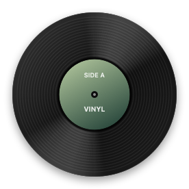

# Vinyl · Spotify 黑膠小工具

把正在播放的 Spotify 歌曲變成桌面上的一張小黑膠。

播放時慢慢旋轉，中央同步歌曲封面；滑鼠移上去才顯示歌名、歌手和上一首／播放暫停／下一首。移開後，只留一張唱片。

<p align="center">
  
  
</p>

[下載 Mac 版本](https://github.com/jeff960149-rgb/spotify-vinyl/releases/latest) · [English](README.md)

## 安裝

需要 **macOS 14 以上、Apple Silicon Mac，以及 Spotify 桌面版**。已在 macOS 26.6.2 的 Apple Silicon Mac 測試；目前介面為繁體中文。

1. 到 [Releases](https://github.com/jeff960149-rgb/spotify-vinyl/releases/latest) 下載 `Vinyl-macOS-arm64.zip`。
2. 解壓縮，把 `Vinyl.app` 放進「應用程式」後開啟。
3. macOS 詢問時，允許 Vinyl 控制 Spotify。
4. 在 Spotify 播放一首歌，封面就會出現在黑膠中央。

這是尚未經 Apple 公證的早期版本，只有本機程式碼簽章。首次開啟可能被 macOS 阻擋；若你決定信任這個版本，可依照 [Apple 官方說明](https://support.apple.com/en-hk/102445)，在「系統設定 → 隱私權與安全性」處理開啟提示。也可以自行檢視原始碼並編譯。

## 操作

- **滑鼠移入**：顯示歌名、歌手與播放控制。
- **滑鼠移開**：回到純唱片外觀。
- **拖曳外圈**：移動位置，下次開啟會記住。
- **右鍵唱片／點選選單列唱片圖示**：切換小／中／大尺寸、顯示／隱藏、重設位置與結束程式。
- **Spotify 收起後才顯示**：在 Spotify 最小化、隱藏，或目前桌面沒有它的主視窗時顯示。預設關閉，可從選單開啟。

黑膠播放時旋轉、暫停時停止。小尺寸也保留清楚的歌名與歌手字體。開啟 macOS「減少動態效果」時，不會旋轉。

## 自行編譯

安裝 Apple Command Line Tools 後：

```sh
git clone https://github.com/jeff960149-rgb/spotify-vinyl.git
cd spotify-vinyl
./scripts/build.sh
open build/Vinyl.app
```

只有 Swift 與 macOS 系統框架，無第三方套件。預設使用目前 Mac 的處理器架構；可用 `VINYL_ARCH` 指定 `arm64`／`x86_64`，Intel 版本尚未實機測試。編譯器與 SDK 不相容時，可用 `VINYL_SDK` 指定相容的 SDK 路徑。

執行 `./scripts/smoke-test.sh` 可輸出預覽圖片，並檢查滑鼠狀態、尺寸切換與視窗位置復原；需在已登入的 macOS 桌面環境執行。此檢查不連接 Spotify，也不儲存視窗偏好。

## 權限與限制

透過 Spotify 本機 AppleScript 介面讀取歌曲與控制播放；封面從 Spotify 提供的 HTTPS 網址下載。沒有另外登入、API Key、分析追蹤或開發者伺服器。偏好設定保存在本機。

這是獨立控制器，Spotify 仍負責播放音樂。僅支援 Spotify 桌面版，不支援網頁播放器或 Windows。自動顯示使用視窗尺寸判斷；未來 Spotify 視窗變動可能需要調整。目前沒有自動更新或開機啟動功能。

本專案與 Spotify 官方無關。預覽使用自製預設標籤，沒有附帶歌曲或專輯素材。
